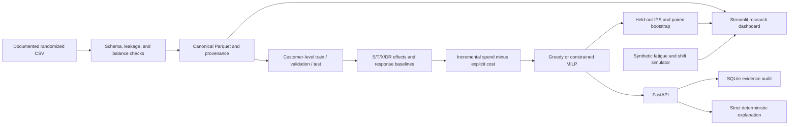

# Next-Best-Action Decision Intelligence Platform

A reproducible system for choosing interventions by estimated incremental effect and net value, then allocating actions under operational constraints. The first empirical benchmark is the randomized Hillstrom email experiment. The system keeps predictive response separate from causal uplift and labels all non-email banking actions and sequential outcomes as simulated.

## Current status

The data pipeline, causal learner interfaces, policy evaluation code, optimizer, synthetic simulator, deterministic explanation layer, REST API, SQLAlchemy/SQLite audit store, and six-view Streamlit dashboard are implemented. The 64,000-row Hillstrom source has now passed validation; the real-data analysis, model training, and held-out policy evaluation are complete. A source category typo (`Surburban`) is normalized to `Suburban` in the processed copy; the raw CSV is preserved unchanged. See [real-data results](reports/generated/real_data_results.md), generated tables in `reports/generated/`, and the [research report](reports/research_report.md). The historical email experiment does not validate banking interventions or guarantee live campaign performance.

## Architecture



## Setup

### Windows PowerShell

From this project directory:

```powershell
py -3.12 -m venv .venv
.\.venv\Scripts\Activate.ps1
python -m pip install --upgrade pip
python -m pip install -e ".[dev,service,dashboard]"
```

If PowerShell blocks environment activation, call the interpreter directly as `.\.venv\Scripts\python.exe` for each command.

### macOS/Linux

```bash
python3 -m venv .venv
source .venv/bin/activate
python -m pip install --upgrade pip
python -m pip install -e ".[dev,service,dashboard]"
```

## Obtain and process Hillstrom data

The [MineThatData experiment page](https://blog.minethatdata.com/2008/03/minethatdata-e-mail-analytics-and-data.html) documents the randomized experiment and links to the CSV. The acquisition script uses that exact documented URL with TLS verification enabled. If it fails, download the original CSV from that page and save it unchanged to `data/raw/hillstrom.csv`.

```powershell
python scripts/run_pipeline.py
```

That command checks or attempts to download the raw file, validates its schema and categories, writes canonical Parquet separately, captures provenance/checksum, and generates the data quality and average-effect reports. It will stop with manual instructions if acquisition fails; it never substitutes synthetic data.

To validate a manually downloaded source before processing:

```powershell
python scripts/validate_data.py
```

Raw data is excluded from Git. The source dataset has no native customer identifier; the pipeline assigns a stable row key that must not be used to join to external customer records. The feature list contains only pre-treatment fields. Visit, conversion, and spend are outcomes measured after treatment.

## Train and evaluate

Run these only after the real-data pipeline succeeds:

```powershell
python scripts/train_models.py
python scripts/evaluate_policies.py --budget 25 --mens-cost 0.01 --womens-cost 0.01
```

Model selection occurs on the validation partition. Policy evaluation uses the held-out randomized test partition with documented one-third assignment probabilities and IPS. The default email costs and $25 evaluation budget are illustrative assumptions, not observed source facts; change them explicitly for sensitivity analysis. Model and policy outputs are written under ignored `artifacts/` and `reports/generated/` directories.

## Synthetic sequential simulation

```powershell
python scripts/run_simulation.py --policy incremental_net_value
```

Simulation outputs are synthetic assumptions only. Configure period count, contact cap, fatigue, shift, conversion value, and action costs in `configs/simulation.yaml`. These outputs are not evidence of banking results or validation of real treatment effects.

## Tests

```powershell
python -m pytest --basetemp .pytest-tmp
```

The tests use synthetic randomized fixtures and local API tests. They validate software behavior, not the benchmark's real policy value. The same test command runs in GitHub Actions.

## API and dashboard

Run the API in one terminal:

```powershell
python -m uvicorn api.main:app --host 127.0.0.1 --port 8000
```

Run the dashboard in another:

```powershell
python -m streamlit run app/dashboard.py
```

API routes: `GET /health`, `GET /models`, `POST /recommend`, `POST /allocate`, `POST /evaluate`, and `GET /audit/{decision_id}`. The recommendation API accepts externally supplied treatment-effect estimates and explicitly says it does not estimate causal effects. `/evaluate` requires an approved config identifier and currently refuses because no evaluation config is wired to the endpoint. Audit retrieval returns stored evidence and does not regenerate the decision. No real-world banking deployment is claimed.

## Docker

Docker configuration is provided but was not run in this environment:

```powershell
docker compose up --build
```

The API listens on port 8000 and dashboard on port 8501. Local `data/` and `reports/` are mounted into the containers.

## Make targets

Implemented GNU Make targets are `install`, `validate-data`, `analyze`, `train`, `evaluate`, `simulate`, `test`, `api`, and `dashboard`. On Windows, the Python command sequences above avoid requiring GNU Make.

## Research integrity and remaining work

- Hillstrom randomized evidence supports only men's email, women's email, and no email.
- No true individual treatment effect is observed; heterogeneous rankings require held-out evaluation and stability checks.
- Simulated bank actions are not mapped to randomized email effects.
- No empirical values are reported until the real CSV passes validation and the pipeline is executed.
- EconML causal forest, DoWhy sensitivity/refutation, MLflow tracking, a live monitoring job, trained artifact loading in the API, value-of-information analysis, and full empirical visualizations remain incomplete. Offline drift diagnostics are implemented but do not assess causal-effect drift.
- Docker and clean-environment installation remain unverified.

The technical report records the currently implemented methods and explicitly marks empirical findings incomplete: [reports/research_report.md](reports/research_report.md).
